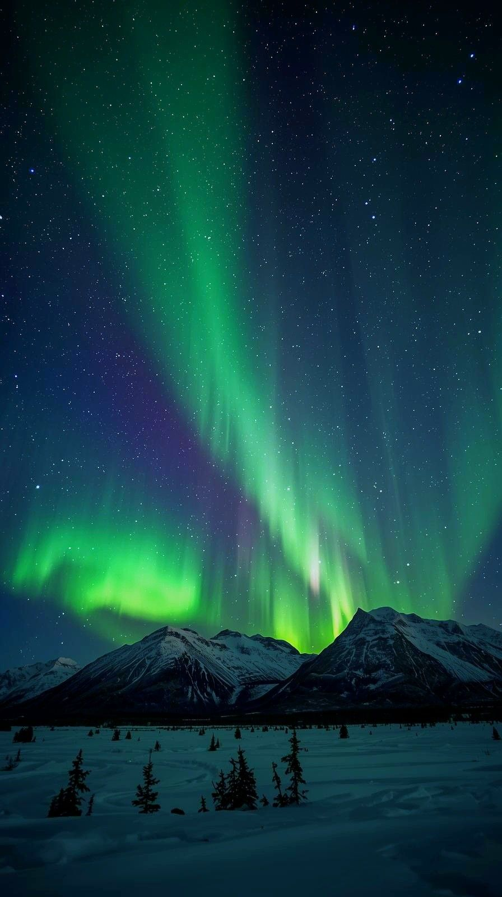

# Aurora Go — прогноз северного сияния

Веб-сервис для планирования наблюдения северного сияния в Мурманской области:
показывает ближайшие «окна» для наблюдения по точкам и позволяет сравнить их между собой.



## Возможности

- **Карта точек наблюдения** — Мурманск, Териберка, Ловозеро, Кировск, Абрам-Мыс и другие.
- **Окна наблюдения** — ближайшие ночные интервалы по 3 часа.
- **Сравнение точек** — выбрать минимум две точки и сравнить прогноз в одном интервале.
- **Актуальность данных** — подгружаются с сервера, без перезагрузки страницы.

## Стек

- **Бэкенд** — Python, FastAPI, Uvicorn
- **Фронтенд** — JavaScript, HTML, CSS
- **Данные** — NOAA SWPC (геомагнитная активность) + Open-Meteo (облачность)

## Установка

```bash
git clone https://github.com/AnastasiiaShibko/aurorago-site.git
cd aurorago-site

python -m venv .venv
# Windows:
.venv\Scripts\activate
# macOS / Linux:
source .venv/bin/activate

pip install -r requirements.txt
uvicorn main:app --reload